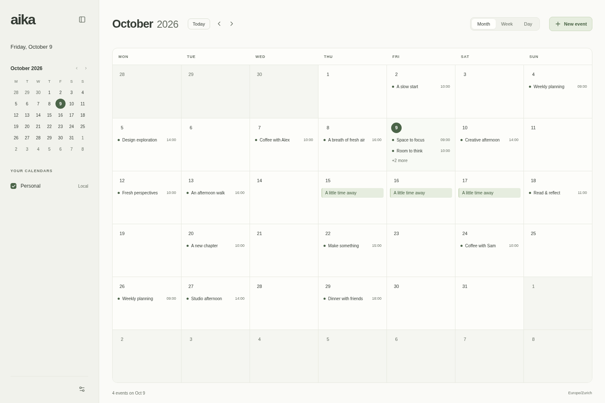

# aika

A desktop calendar that keeps your day clear and your calendars close. Plan your time, edit with a drag, and keep working offline.

**[Download releases](https://github.com/EPMatt/aika/releases) · [Contribute](CONTRIBUTING.md) · [Buy Me a Coffee](https://buymeacoffee.com/epmatt)**

<picture>
  <source media="(prefers-color-scheme: dark)" srcset="docs/images/month-dark.png">
  <source media="(prefers-color-scheme: light)" srcset="docs/images/month-light.png">
  
</picture>

- **See your time:** month, week, and day views, with multiple calendars, colors, and visibility controls.
- **Edit naturally:** drag to create, move, and resize events; add notes and locations; undo event changes during your session.
- **Repeat your routines:** daily, weekly, monthly, and yearly local events, with individual-occurrence and series editing.
- **Keep planning offline:** local calendars and preferences stay on your device in SQLite and reopen after restart.
- **Make it comfortable:** light, dark, and system themes, plus keyboard controls for navigation and editing.
- **Work from the terminal:** the [aika CLI](docs/cli.md) shares your calendar data with the desktop app.
- **Connect Google Calendar (experimental):** account connection, synchronization, and two-way event editing.

Available for Linux, Windows, and macOS. aika is in alpha; see the [candidate notes](docs/alpha/RELEASE-NOTES.md) and [installation guide](docs/releases.md).

Press **N** for a new event, **T** for today, **1 / 2 / 3** for month / week / day, **Ctrl/Cmd+Z** to undo, and **Escape** to dismiss the editor.

Learn more about [Google Calendar](docs/integrations/google-calendar.md), the [architecture](docs/architecture.md), and [what’s next](docs/roadmap.md).
